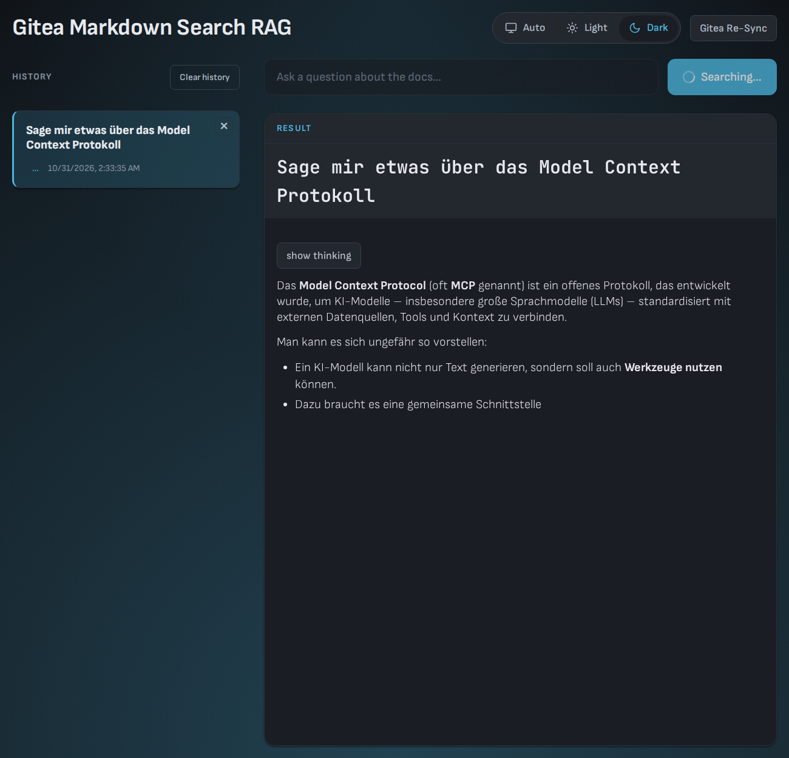

<p align='center'>
  <h1 align='center' style='margin-bottom:0px'>gitea-qdrant-sync</h1>
  <p align='center'>RAG + MCP + Web UI</p>
</p>

<p align="center">
  
  
  
  
  
  
  
  
  
</p>

[](.docs/screenshots/search.webm) 

- A Node.js service that synchronizes **Markdown** files from **Gitea** repositories into a [Qdrant](https://qdrant.tech) vector database.
- On a push event, the affected Markdown files are fetched, split into chunks, converted into embeddings with the help of an LLM (e.g. [Ollama](https://ollama.com)) and stored as points with metadata in Qdrant.
- This creates a vector-based search and retrieval source (RAG) for the repository documentation. Questions can be answered via the `/search` endpoint, which retrieves relevant chunks and generates an answer with a chat LLM. 

- The service also exposes an [MCP](https://modelcontextprotocol.io) (Model Context Protocol) server over [Streamable HTTP](https://modelcontextprotocol.io/docs/concepts/transports#streamable-http-transport) at `/mcp`, exposing `ask`, `search`, `sync` and `sync-all` tools for use by AI assistants such as Claude Code, Cursor, or any MCP-compatible client.  

Done by Matthias Kallenbach | [skwncr.net](https://skwncr.net) 
Using a local LLM:
 - llama.cpp
 - opencode / kilo code
 - VS Code + kilo code extension
 - Tiel Coder 35B A3B MTP UD Q4_K_XL
 - NVIDIA Nemotron 3.5 Bolt 74B A9B 24GB GGUF
 - Qwen3.8 + Draft Model

## Prerequisites

- **Docker** (recommended) or Node.js 20+ for local development.
- A running **[Qdrant](https://qdrant.tech)** instance reachable at `QDRANT_URL`:`QDRANT_PORT`.
- An LLM host supporting the embedding and chat APIs you configure (`EMBEDDINGS_API`, `CHAT_API`), e.g. [Ollama](https://ollama.com) or a llama.cpp-compatible OpenAI endpoint.
- A Gitea instance with an API token for webhook-triggered syncs.

The service itself does not host Qdrant, the embedding model, or the chat LLM — it only orchestrates fetching from Gitea and reading/writing to those external services. Provide their URLs via environment variables (see Configuration).

## How it works

1. A push event in a Gitea repository triggers the `/webhook` endpoint.
2. All added, changed and removed `.md` files are collected.
3. Each file is fetched via the Gitea API as raw content. If a file no longer
   exists in the repository (HTTP 404), its previously indexed points are
   removed from Qdrant instead of being re-upserted.
4. The content is split into chunks with a recursive Markdown splitter that splits at hierarchical boundaries (headings `#`/`##`/`###`, blank-line separated paragraphs, newlines) and merges the parts up to a configurable size (`QDRANT_CHUNK_MAX_SIZE`, default `768`) without breaking those boundaries.
5. Each chunk is converted into a vector via the LLM's embedding API.
6. The vector, together with the text (as `text`) and the metadata
   (`source`, `repository`), is stored via `upsert` in the Qdrant collection.
   Existing points for the same source are deleted first, so re-syncing a file
   keeps the collection up to date.
7. On a `/search` request, the question is embedded, the most relevant chunks are
   retrieved from Qdrant, and a chat LLM generates an answer based solely on that
   context (RAG).

## Installation and Start with Docker

Copy `.env.default` to `.env` and fill in the required variables:

```bash
cp .env.default .env
```

Start the service with Docker Compose:

```bash
docker compose up --build
```

For local development with hot reload:

```bash
docker compose -f compose-local-dev.yml up --build
```

The service is exposed on the port defined by `SERVER_PORT` (default `3000`).

Qdrant and the embedding/chat LLM host must be provisioned separately — this
service only fetches from Gitea and reads/writes to those external services.
Provide their URLs via environment variables.

## Configuration

The environment variables take precedence over `config.json`. In Docker they are passed via `compose.yml` using a `.env` file:

| Variable                  | Description                                                                                                             |
| ------------------------- | --------------------------------------------------------------------------------------------------------------------- |
| `SERVER_PORT`             | Port the service listens on (default: `3000`)                                                                         |
| `QDRANT_URL`              | Base URL of the Qdrant instance                                                                                       |
| `QDRANT_PORT`             | Port of the Qdrant instance (default: `80`)                                                                           |
| `QDRANT_COLLECTION`       | Name of the Qdrant collection (default: `research`)                                                                   |
| `QDRANT_CHUNK_MAX_SIZE`   | Maximum size of a chunk in characters (default: `768`)                                                                |
| `SEARCH_TOP_K`            | Number of chunks retrieved from Qdrant for a RAG answer (default: `10`)                                               |
| `EMBEDDINGS_API`          | Embedding backend: `ollama` (default) posts to `{URL}/api/embed`, `openai` posts to `{URL}/embeddings`               |
| `EMBEDDINGS_URL`          | Base URL of the embedding LLM host (e.g. `http://localhost:11434` for Ollama or `http://localhost:8080/v1` for llama.cpp) |
| `EMBEDDINGS_HOST`         | Optional `Host` header sent with embedding requests (useful behind a reverse proxy)                                   |
| `EMBEDDINGS_MODEL`        | Embedding model name (default: `nomic-embed-text`)                                                                    |
| `CHAT_API`                | Chat backend: `ollama` (default) posts to `{URL}/api/chat`, `openai` posts to `{URL}/chat/completions`               |
| `CHAT_URL`                | Base URL of the chat LLM host                                                                                         |
| `CHAT_MODEL`              | Chat model name                                                                                                        |
| `LLM_SYSTEM_PROMPT`       | System prompt used by the chat LLM when generating RAG answers                                                        |
| `GITEA_API_URL`           | Base URL of the Gitea API                                                                                             |
| `GITEA_TOKEN`             | Personal Access Token for the Gitea API                                                                               |
| `MCP_ENABLED`             | Enable the MCP server (`true` by default)                                                                             |
| `MCP_PATH`                | MCP endpoint path (default: `/mcp`)                                                                                   |
| `MCP_ALLOWED_HOSTS`       | Comma-separated list of allowed hostnames for DNS rebinding protection (e.g. `localhost,127.0.0.1,[::1]`)             |
| `CONFIG_PATH`             | Path to `config.json` (default: `./config.json`)                                                                      |

The older `LLM_URL`, `LLM_API` and `MODEL_NAME` variables are still supported as
fallbacks for `EMBEDDINGS_URL`, `EMBEDDINGS_API` and `EMBEDDINGS_MODEL`.

Default values are applied in memory when `config.json` is absent. The file is
not written automatically; call `Config.saveDefaults()` to write a sample
`config.json` to the `CONFIG_PATH` location.

## MCP (Model Context Protocol)

- The service exposes an MCP server at `/mcp` (configurable via `MCP_PATH`).
- Connect any MCP-compatible client (Claude Code, Cursor, etc.) to 
  ```bash
  http://<host>:<port>/mcp
  ```
- The server identifies as `gitea-qdrant-sync v1.0.0` and advertises `tools` capability.

### Tools

| Tool      | Description                                                                                              |
| --------- | -------------------------------------------------------------------------------------------------------- |
| `ask`     | Answers a question using RAG (vector search in Qdrant + chat LLM). Takes a `question` string argument.  |
| `search`  | Searches the synchronized documentation with vector search in Qdrant. Returns raw chunks with scores and metadata. Takes a `question` string argument. |
| `sync`    | Triggers a full sync of all Markdown files in a Gitea repository. Takes `repository` (`owner/repo`) and optional `ref` arguments. |
| `sync-all`| Synchronizes all Markdown files of all Gitea repositories known to Qdrant. Runs in the background. Takes no arguments. |

### Example usage

```bash
# Initialize MCP session (stateless HTTP)
curl -X POST http://localhost:3000/mcp \
  -H 'Content-Type: application/json' \
  -d '{"jsonrpc":"2.0","id":1,"method":"initialize","params":{"protocolVersion":"2024-11-05","capabilities":{},"clientInfo":{"name":"test-client","version":"1.0"}}}'

# List available tools
curl -X POST http://localhost:3000/mcp \
  -H 'Content-Type: application/json' \
  -d '{"jsonrpc":"2.0","id":2,"method":"tools/list","params":{}}'

# Call the ask tool (RAG with LLM)
curl -X POST http://localhost:3000/mcp \
  -H 'Content-Type: application/json' \
  -d '{"jsonrpc":"2.0","id":3,"method":"tools/call","params":{"name":"ask","arguments":{"question":"How do I configure the webhook?"}}}'

# Call the search tool (raw Qdrant chunks)
curl -X POST http://localhost:3000/mcp \
  -H 'Content-Type: application/json' \
  -d '{"jsonrpc":"2.0","id":4,"method":"tools/call","params":{"name":"search","arguments":{"question":"How do I configure the webhook?"}}}'

# Trigger a full repo sync
curl -X POST http://localhost:3000/mcp \
  -H 'Content-Type: application/json' \
  -d '{"jsonrpc":"2.0","id":5,"method":"tools/call","params":{"name":"sync","arguments":{"repository":"myorg/myrepo","ref":"main"}}}'

# Sync all repositories known to Qdrant
curl -X POST http://localhost:3000/mcp \
  -H 'Content-Type: application/json' \
  -d '{"jsonrpc":"2.0","id":6,"method":"tools/call","params":{"name":"sync-all","arguments":{}}}'
```

Each request is stateless — no session management required.


### Architecture

Built with MCP TypeScript SDK v2 using a stateless per-request factory pattern:
- `createMcpHandler()` creates a handler from a factory function
- `toNodeHandler()` adapts the handler for Express
- Each request gets a fresh `McpServer` instance via `McpService.createServer()`
- No shared transport state — scales horizontally without session management


### Configuration

| Variable              | Description                                                                                                             |
| --------------------- | ----------------------------------------------------------------------------------------------------------------------- |
| `MCP_ENABLED`         | Enable the MCP server (`true` by default)                                                                               |
| `MCP_PATH`            | MCP endpoint path (default: `/mcp`)                                                                                     |
| `MCP_ALLOWED_HOSTS`   | Comma-separated list of allowed hostnames for DNS rebinding protection (e.g. `localhost,127.0.0.1,[::1]`)               |

When `MCP_ALLOWED_HOSTS` is set, requests with a `Host` header not in the list are rejected with `403`.

## Development

### Local start

```bash
# install
npm install

# run
SERVER_PORT=3000 \
QDRANT_URL=http://localhost:6333 \
QDRANT_PORT=6333 \
QDRANT_COLLECTION=research \
QDRANT_CHUNK_MAX_SIZE=768 \
EMBEDDINGS_API=ollama \
EMBEDDINGS_URL=http://localhost:11434 \
EMBEDDINGS_MODEL=nomic-embed-text-v2-moe:latest \
CHAT_API=ollama \
CHAT_URL=http://localhost:11434 \
CHAT_MODEL=loaded \
GITEA_API_URL=https://gitea.example.com \
GITEA_TOKEN=your-token \
node index.js
```

### Frontend

- The service ships a small Vite + React (19) web UI in `frontend/` that answers
  questions against the synchronized documentation via `POST /search`. 
- It uses `@tanstack/react-query` for data fetching, `react-router-dom` for routing and
  hand-written CSS in `src/style/` (no TypeScript, matching the rest of the repo).
- The UI also includes a "Gitea Re-Sync" button that triggers a background
  re-sync of all repositories via `POST /sync-all`.
- A theme switcher in the header toggles between `auto`, `light` and `dark`
  color themes (default: `dark`). The choice is persisted in `localStorage`.

The Express server serves the UI transparently: in development it runs the Vite
dev server as middleware (hot reload), in production it serves the built files
from `frontend/dist` with a SPA fallback (`server/frontendRouter.js`).

#### Develop

```bash
cd frontend
npm install
npm run dev
```

In development the Vite dev server is embedded in the Express app, so no separate
proxy is needed. The UI talks to the backend same-origin by default; override
with `VITE_API_BASE` if required.

#### Build

```bash
cd frontend
npm run build
```

The production build is created automatically by the Dockerfile before the server
starts (see `compose.yml`).

#### Screenshots

The media in the README header is generated by a Playwright script:

```bash
npm run screenshots
```

It captures `dashboard.png`, a mid-stream `search-answer.png` and a
`search.webm` recording into `.docs/screenshots/`. It requires a running
instance (default `http://localhost:3000`, override with `BASE_URL`).

## Endpoints

### `GET /`

The Web UI

### `POST /webhook`

Called by Gitea. Processes only events of the type `x-gitea-event: push`. The payload matches the Gitea push webhook (`repository`, `commits` with `added`/`modified`).

### `POST /search`

Accepts a JSON body with a `question` field and returns `{ "answer": "..." }` based on the synchronized documentation. Returns `404` if no answer could be generated.

### `POST /search/stream`

Streams the RAG answer as Server-Sent Events. Accepts a JSON body with a `question` field. Yields events of type `status` (embedding/search/thinking phases), `thinking` (reasoning tokens), `answer` (content tokens), `empty` (no results), `done` (completion), and `error`. Useful for displaying progressive answers in the frontend.

### `POST /sync-all`

Triggers a background re-sync of all Markdown files of all Gitea repositories known to Qdrant. Returns `{ "status": "started", "message": "..." }` with HTTP 202. The frontend shows a "Gitea Re-Sync" button that calls this endpoint.

### `GET /health`

Returns the service status: `{ "status": "ok" }`.

## Set up Gitea webhook

In a repository under *Settings → Webhooks → Gitea Webhook*, create a new webhook
with the following URL:

```
http://<service-host>:<port>/webhook
```

"Push" must be enabled as the event type. The `x-gitea-event` header is validated
automatically by the service.

## Notes on customization

In `server/config.js`, default values for the embedding model (`embeddingsModel`, default `nomic-embed-text`), the chat model (`chatModel`), the Qdrant collection (`qdrantCollection`, default `research`) and the maximum chunk size (`qdrantChunkMaxSize`, default `768` characters per chunk) can be changed. The chunking uses a recursive Markdown splitter in `server/sync.js`. The point ID generation in `server/qdrant.js` (`upsert`) uses a SHA-256 hash of the chunk text and repository URL, making it content-stable and idempotent: re-syncing the same file replaces existing points rather than duplicating them.

